# ModKeeper

One desktop library for every mod on your PC (Steam Workshop, Nexus/Vortex, Mod Organizer 2, game `Mods` folders), every Minecraft instance (Prism Launcher, CurseForge, Modrinth App, the official launcher) and your emulator library. It keeps your mods safe: nothing gets overwritten or deleted without your OK.

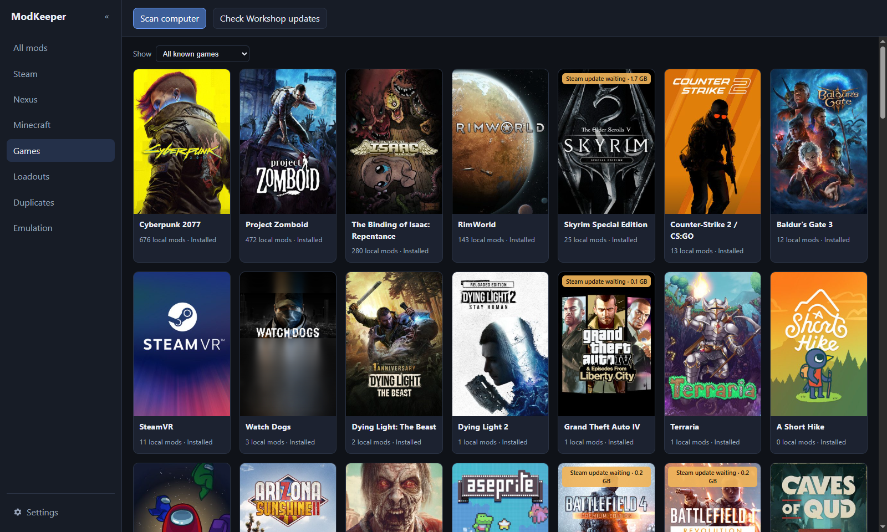

## Your mods stay yours

Steam and Vortex can change your mods without asking. Steam updates a subscribed Workshop mod (or removes it if the author takes it down), and Vortex can delete or replace a download. ModKeeper gives you a copy that only changes when you say so.

- **Keep & unsubscribe:** copies a Workshop mod into a folder Steam doesn't manage (the game's own local mods folder where it supports one), then unsubscribes. From then on Steam can't update or delete it. You choose when to update with **Update copy**, and the previous version is saved first.
- **Archive vault:** every Vortex download archive gets a hard link in ModKeeper's vault. A hard link is a second name for the same file, so it costs no extra disk space. If Vortex deletes or replaces the archive, ModKeeper still has the old one and shows it on the mod's card.
- **Removed from the Workshop:** mods the author hid or deleted keep their last-known details instead of turning into a bare ID.
- **ModKeeper itself asks first:** unsubscribing, deleting (to the Recycle Bin only) and changing a game's mod list only happen when you click. Every config file it changes is backed up first, and it refuses to write while the game is running.

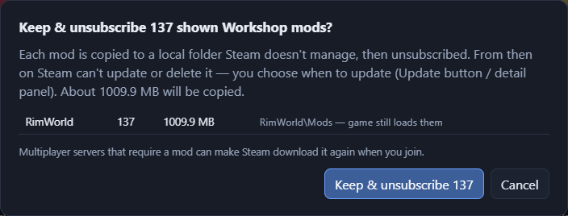

## Library

All your mods in one list, from Steam Workshop (all Steam libraries), game `Mods` folders, Vortex staging and downloads (with Nexus metadata), Mod Organizer 2, Thunderstore profiles and Prism Launcher (Minecraft). Search and filter by game, source and in-game state, or hide games you don't mod.

Three views:

| Grid | List | Carousel |
|---|---|---|
| 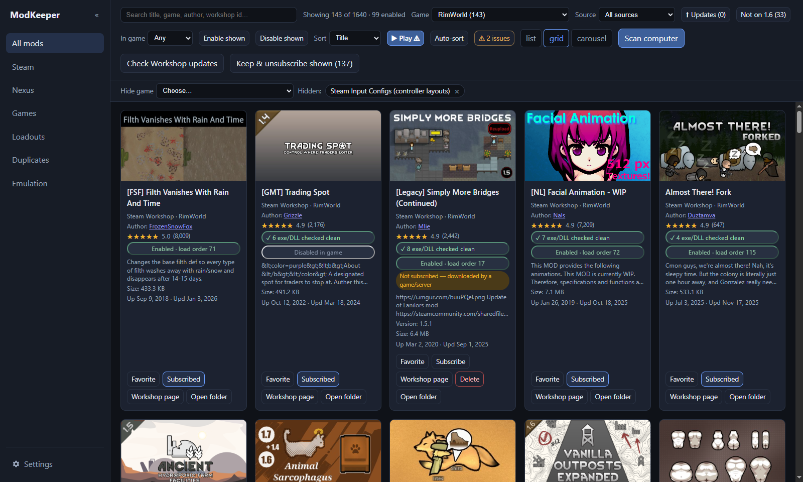 | 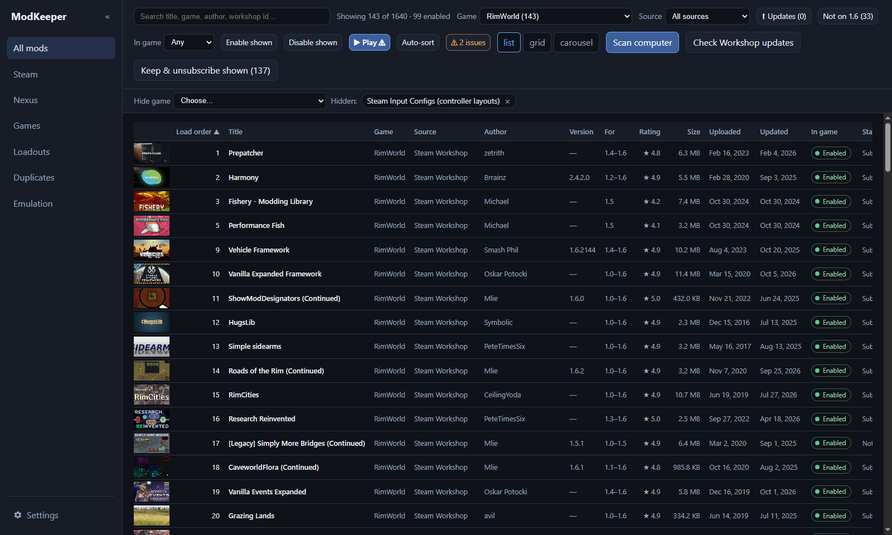 | 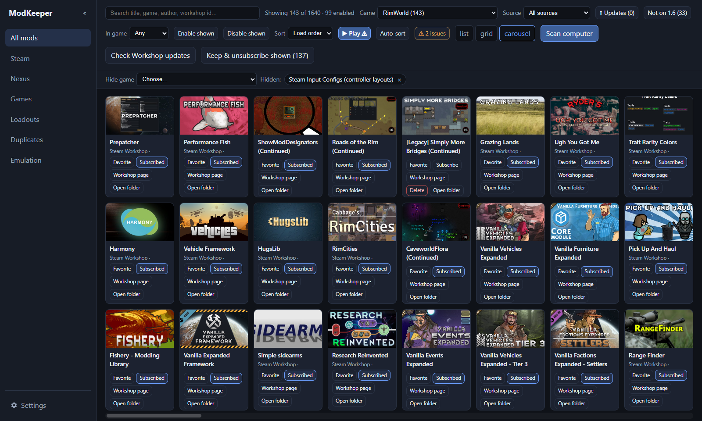 |

- **Updates:** Workshop update detection, Nexus version checks with your API key, Modrinth updates for Prism instances. Change notes are shown in the detail panel.
- **Steam:** browse the Workshop inside ModKeeper: ratings, popularity and descriptions; filter by when mods were made (past week to past year) and by the game's own tags (such as Build 41 / Build 42); the total count and page number; favorite, install or subscribe from the card. **Downloaded / installed** shows what's on disk or what you've liked, including liked mods you haven't installed yet. Subscribe and unsubscribe go through the running Steam client, and re-uploads of removed mods can be found.

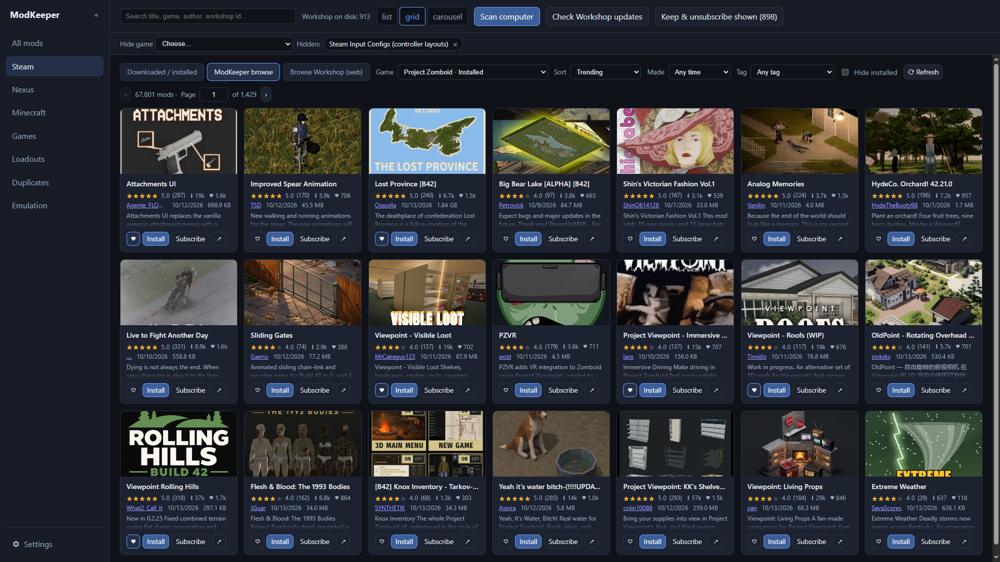

- **Duplicates:** the same mod installed twice (similar titles, the same mod ID, the same Workshop item or Nexus mod in more than one place). You can mark a pair "not duplicates".

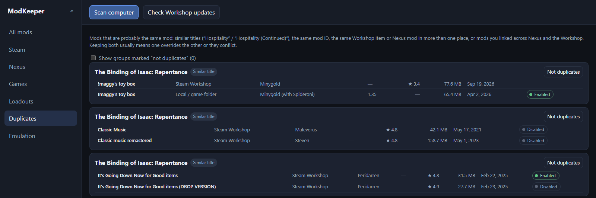

## Load order

- **On/off in the game's own list:** RimWorld `ModsConfig.xml`, Project Zomboid `mods\default.txt` (and per-save lists), Isaac `disable.it`. These are the same files the games read, so nothing is hidden in a ModKeeper-only format.
- **RimWorld:** Auto-sort from each mod's About.xml rules (dependencies, load after/before), so only rule-breaking mods move. You can also drag to reorder. Missing or disabled dependencies are listed with a link to find them. Nothing is saved until you click Save order.
- **Skyrim SE:** plugin load order with master checks, Vortex ↔ MO2 plugin sync, copying Vortex mods into MO2 (copy-only, Vortex is left as it is), and a crash log reader.
- **Baldur's Gate 3:** reads `.pak` metadata, checks dependencies and Script Extender, and shows Vortex's deployment (read-only).
- **Play:** launches the game with its mod list in place (or through MO2 for MO2 setups).

## Loadouts

Saved mod lists per game: RimWorld mod lists (`.rml`, the same ones the in-game Mod Lists menu uses), Project Zomboid saved lists and per-save lists, ModKeeper lists for Isaac, and MO2 profiles for Skyrim. Apply, update, edit, save the current setup as a new list, and share a list as a code someone else can import.

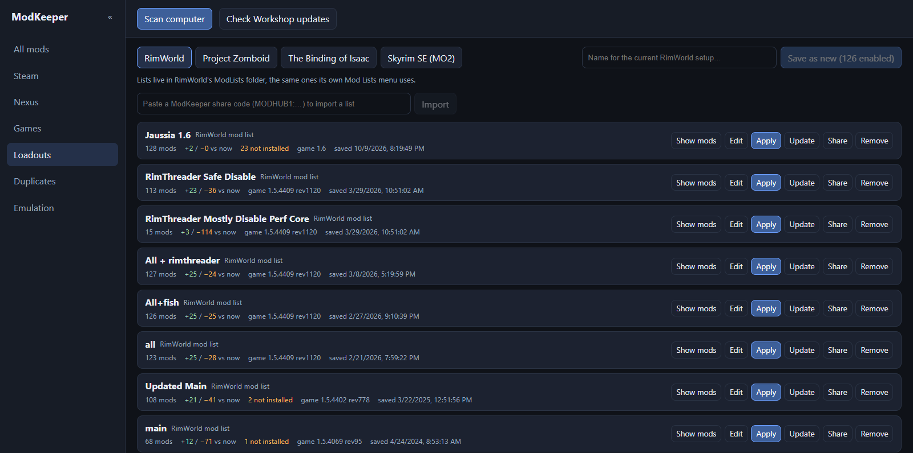

## Minecraft

One tab for every Minecraft instance on the PC: Prism Launcher, CurseForge, the Modrinth App and the official launcher's `.minecraft`. Clicking Minecraft in Games opens it.

- **Mods:** on/off the way the launchers do it, missing-dependency warnings, updates from Modrinth or CurseForge, and modlists to switch between sets of mods.
- **Resource packs** (on/off and order), **shaders** (pick the active pack for Iris or OptiFine) and **screenshots**.
- **Worlds:** created date, age, time played, difficulty and data packs, rename, back up to a zip, and a **top-down map** centred on your bed, where you were, world spawn or friends' beds (Minecraft 1.18 and newer).
- **Browse** Modrinth (no account) or CurseForge (add your free API key in Settings → Accounts): results are filtered to the instance's Minecraft version and loader, installed ones are marked, and Install brings in required dependencies.

Downloads are hash-checked and scanned with Microsoft Defender. Updates keep the old file in ModKeeper's backups, deletes go to the Recycle Bin, and nothing changes while the instance is running.

| Browse | Mods | World map |
|---|---|---|
| 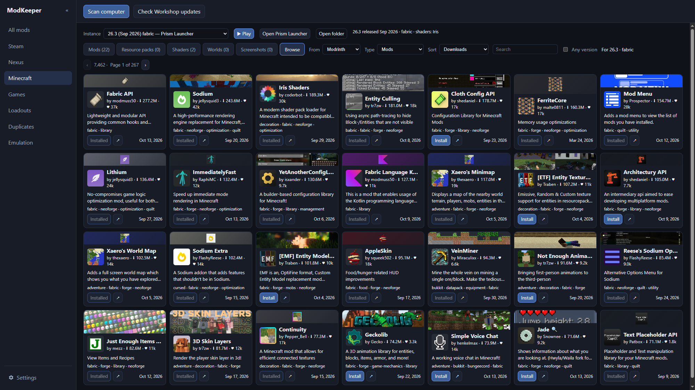 | 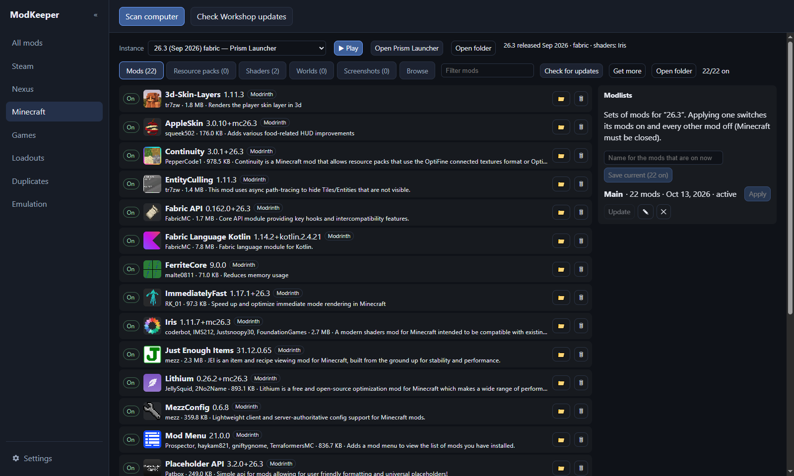 | 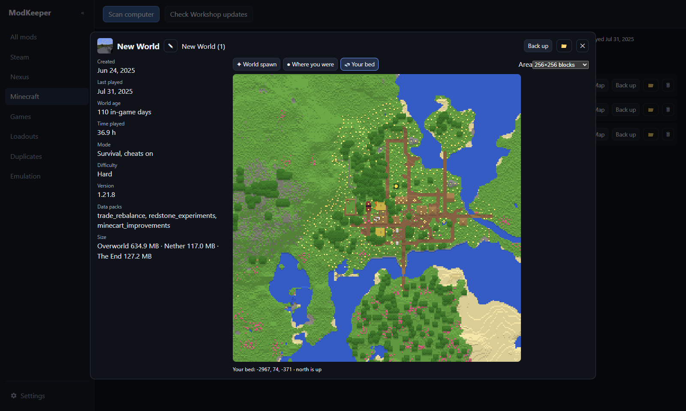 |

## Emulation

An organizer for your own ROM and emulator library folder.

- ROMs listed by console, with region, revision and verified-dump tags read from the file name, plus duplicates.
- **Where each file lives:** synced to your other devices (Syncthing folders are detected), in the ROMs folder, or elsewhere on the PC.
- **RetroArch saves and save states** per game, and when you last played.
- **Romhacks and randomizers** show their name, author, version and the original game. These are detected from the ROM, or read from a `romhacks.json` you keep in the library.
- **Play** opens RetroArch with the console's core, or BizHawk.
- **PC ports:** decomp ports such as the Minish Cap PC port get Play and Build buttons.
- **Read-only:** ModKeeper never moves, edits or uploads ROMs, and never writes into synced folders.
- **Mods & modlists:** packs for Ship of Harkinian, 2 Ship 2 Harkinian and Starship (pick the game from a dropdown), kept in step with the game's own mod list: on/off, load order (top wins), rename, delete (to the Recycle Bin) and Update for packs installed from GameBanana (the old pack is backed up). Packs with alternate assets are marked `alt`, and a tick box sets Ship's Alternate Assets on at startup. Modlists save which packs are on and their order; apply, update or rename them. Ship's settings file is backed up before every change, and nothing is changed while Ship is running.
- **GameBanana:** browse the Mods section of any GameBanana game (Ship of Harkinian by default): likes, downloads, descriptions, sort, search and page numbers. Mods GameBanana marks mature carry an **18+** badge; turn **Show mature mods** off in Settings to hide them. **Install** lets you pick which files when a mod has several, checks GameBanana's checksum, scans with Defender, and puts packs for Ship of Harkinian, 2Ship and Starship straight into their mods folder (other games: the download is shown in Explorer). Favorites are kept in ModKeeper; **Like ↗** opens the mod on GameBanana (liking needs your GameBanana login).

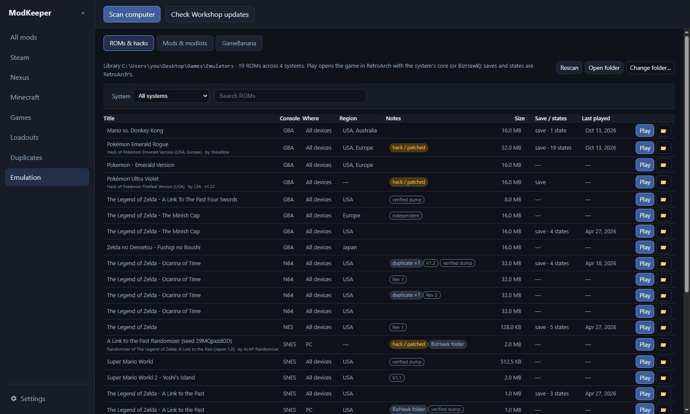

| Ship of Harkinian mods | GameBanana |
|---|---|
| 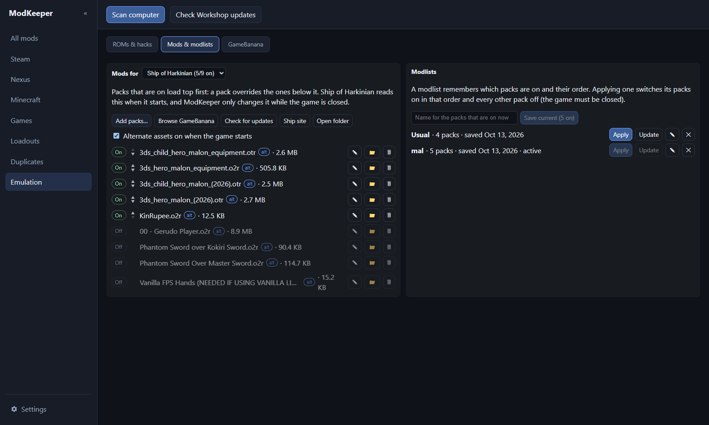 | 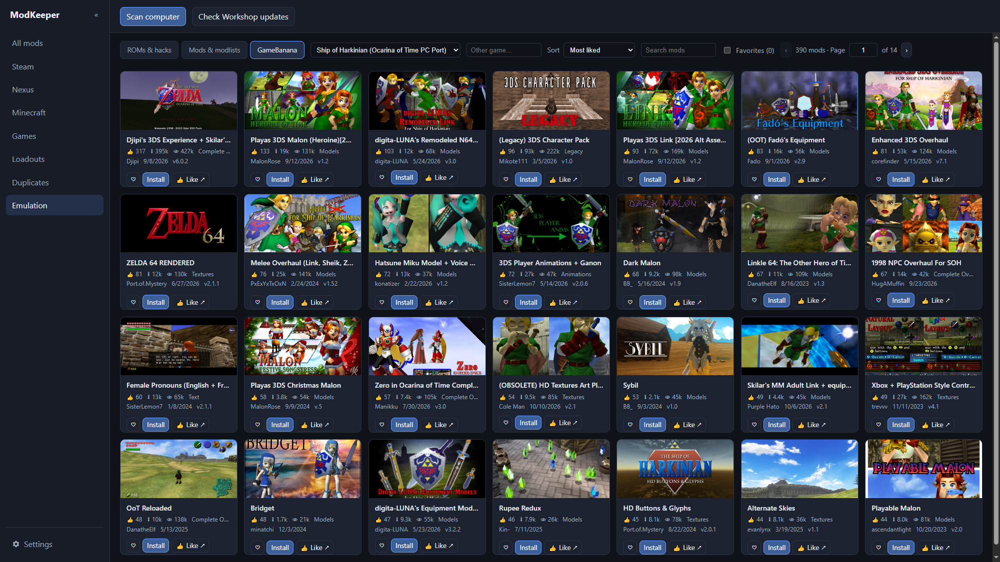 |

## Security

Mods are other people's code. ModKeeper counts the programs, DLLs and scripts in each mod and checks them with Microsoft Defender. With an optional free VirusTotal key it also checks them by fingerprint (files are never uploaded). There's also a guard that keeps Isaac's LuaDebug off. New or changed mods are checked in the background, and Settings has two buttons for a full pass: **Check all mods with programs/DLLs now**, and **Scan all mod folders (Defender)**, which runs one Defender scan per place mods live (Workshop, Vortex, MO2, game mod folders and the vault), archives included. Details are in [SECURITY.md](SECURITY.md).

## Download

Get the installer from [Releases](https://github.com/Strikeborn/modkeeper/releases) (Windows 10/11, 64-bit). It isn't code-signed yet,
so SmartScreen may warn you: click **More info → Run anyway**. Then click **Scan computer**. Scanning only reads; nothing
changes until you click an action.

## Run from source (Windows)

```powershell
npm install
powershell -File tools\start-mod-hub.ps1        # built app; rebuilds first if sources changed
powershell -File tools\start-mod-hub.ps1 -Dev   # Vite dev server + hot reload + DevTools
```

Use the desktop window titled **ModKeeper**. `http://localhost:5173` in a normal browser has no Electron bridge, so scanning won't work there.
`tools\create-mod-hub-shortcut.ps1` makes a desktop shortcut, and `npm run dist` builds an installer.

## Settings and data

- **Nexus:** your [personal API key](https://www.nexusmods.com/users/myaccount?tab=api+access) for tracking mods, version checks and missing images.
- **VirusTotal (optional):** an API key for fingerprint lookups.
- **CurseForge (optional):** an API key from [console.curseforge.com](https://console.curseforge.com/) for browsing CurseForge in the Minecraft tab.
- **GameBanana:** show or hide mods GameBanana marks mature.
- **Extra paths:** extra mod folders to scan (manual installs, backups), plus the emulation library and PC port folders.
- **Window:** fullscreen on or off, and the hotkey that toggles it (F11 by default; only while ModKeeper has focus).

Data lives in `%APPDATA%\mod-hub\` (catalog, settings, vault, kept mods, config backups, loadouts). The folder keeps its old name so existing data carries over after the rename. Set `MODKEEPER_DATA_DIR` to use a different folder (a fresh profile, or portable use).

## Stack

Electron + Vite + React + TypeScript + CSS. Tests: `npm test` (Vitest).

## Notes

- The injected Nexus browse carousel uses `injectionRuntime.js` from the separate
  [Vortex mod-browser-carousel plugin](https://github.com/Strikeborn/nexus-vortex-mod-browser-carousel) repo, checked out next to this one as
  `vortex-builtin-mod-browser-enhanced/` (not part of this repo).

## License

ModKeeper is free software under the [GNU General Public License v3.0](LICENSE) (or any later version).
You can use, study, change and share it. If you distribute a modified version, it has to stay under the GPL
with its source code available.
